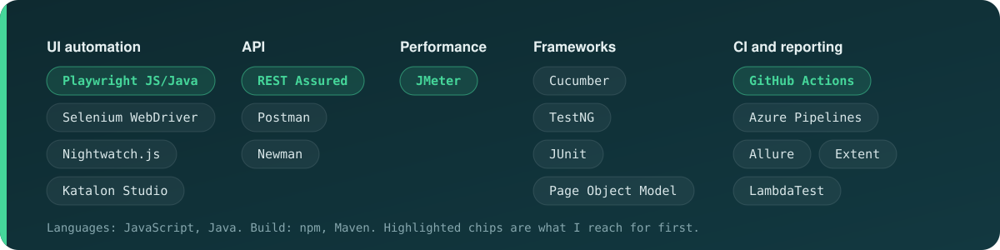

  
  
  
  

I'm a QA automation and performance engineer with 8+ years across insurance, logistics, financial services and SaaS. I'm currently a Test Automation Specialist at BrandHub, previously Lead QA at NashTech and Senior QA at Nimap Infotech. I build frameworks that stay maintainable as the product grows, and pipelines that tell the team what broke and why. I'm ISTQB® certified: Advanced Test Manager, AI Testing, Agile Tester and Foundation Level.

### Featured: Playwright framework for a live e-commerce store

The card above is regenerated by CI on every run, so it always shows current results.

- **[qademo-playwright-e2e](https://github.com/Ammarah95/qademo-playwright-e2e):** Playwright + JavaScript, Page Object Model, 52 scenarios across Chromium, Firefox, mobile emulation and the REST API
- **Pipeline:** GitHub Actions with parallel shards, Allure history and a [live dashboard](https://ammarah95.github.io/qademo-playwright-e2e/), plus a nightly run
- **Real findings:** 2 checkout defects documented and tracked as tests. Two sources of flakiness fixed at the root: a cart-sync race and refresh-token rotation

### Toolbox

### Other test suites

| Project | Stack | What it shows |
|---|---|---|
| [OrangeHRM](https://github.com/Ammarah95/OrangeHRM) | Playwright, JavaScript | Page Object Model suite with saved login state and GitHub Actions |
| [GithubAction_Demo](https://github.com/Ammarah95/GithubAction_Demo) | JMeter | Performance tests running in GitHub Actions and Azure Pipelines |
| [Briix API Automation](https://github.com/Ammarah95/Briix---API-Automation) | Java, REST Assured, Cucumber | BDD API suite with Extent reports |
| [Briix Admin Portal](https://github.com/Ammarah95/Briix-AdminPortal) | Java, Selenium, Cucumber | BDD UI automation for an admin portal |
| [Tala_task](https://github.com/Ammarah95/Tala_task) | Java, REST Assured, TestNG | Data-driven API and UI framework using Apache POI |
| [Nightwatch](https://github.com/Ammarah95/Nightwatch) | Nightwatch.js | End-to-end tests with page objects |
| [AssignmentLambdaTest](https://github.com/Ammarah95/AssignmentLambdaTest) | Playwright for Java | Tests running on the LambdaTest cloud grid |

Hiring for a remote QA Lead, SDET or Test Automation Architect? The quickest way to reach me is <a href="https://www.linkedin.com/in/ammarah-ayubi/">LinkedIn</a>.
